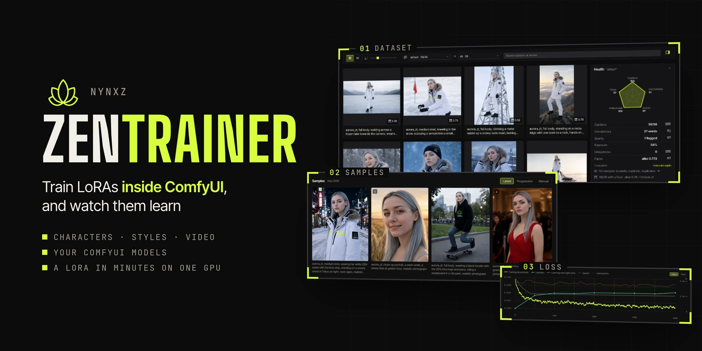
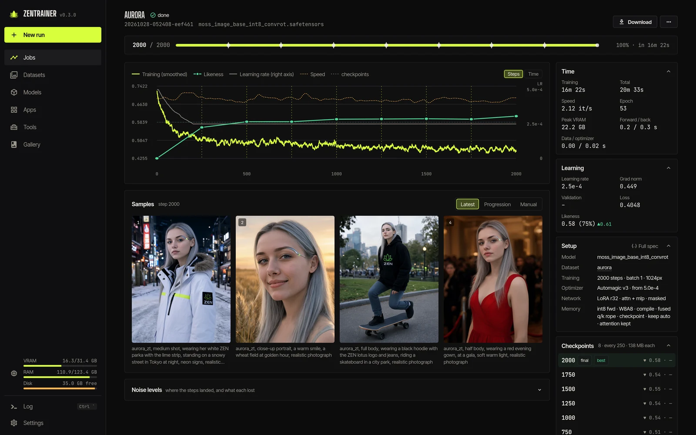
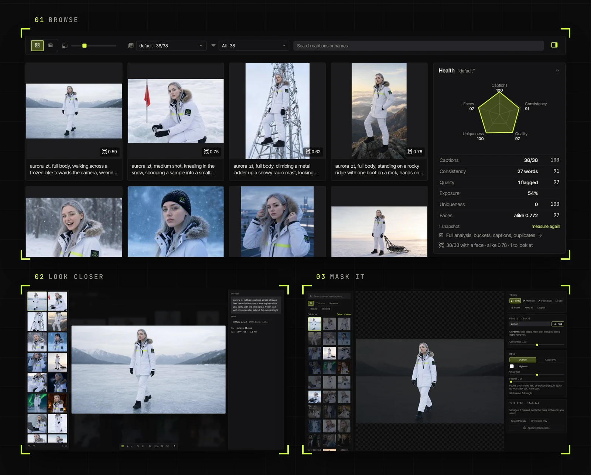
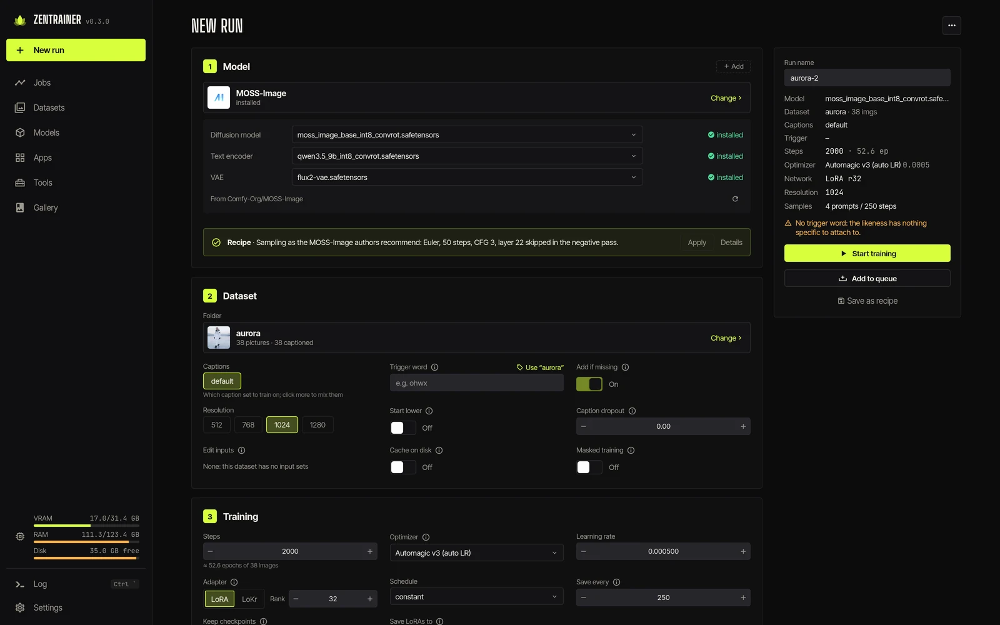
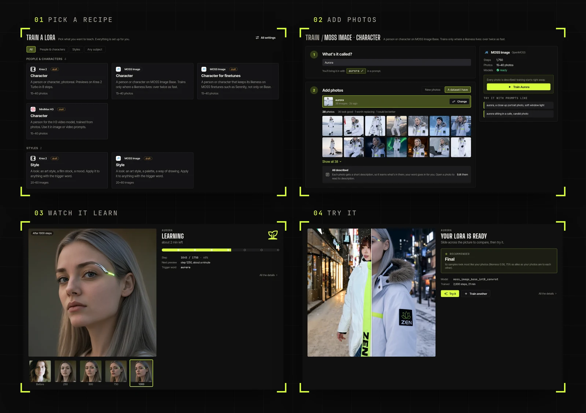
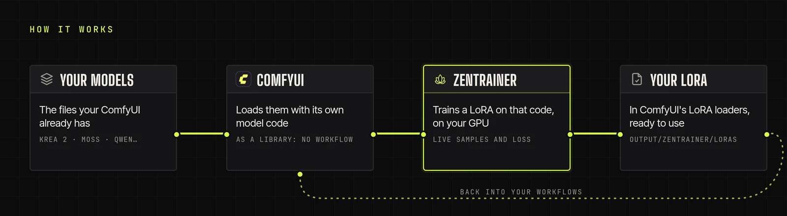

<p>
  <a href="https://github.com/comfyanonymous/ComfyUI"></a>&nbsp;
  <a href="#install"></a>&nbsp;
  <a href="#install"></a>&nbsp;
  <a href="#install"></a>&nbsp;
  <a href="LICENSE"></a>
</p>

Train LoRAs inside ComfyUI, and watch them learn. ZenTrainer trains on ComfyUI's own model code,
with the models and GPU it already has.

- **Characters, styles and video**: Krea 2, MOSS Image, Qwen-Image, Z-Image, SDXL, MiniMax H3 and more
- **Straight into ComfyUI**: trained LoRAs show up in its LoRA loaders
- **Simple or Advanced**: a recipe sets everything, or set every option yourself

## Quick start

1. Install ZenTrainer from ComfyUI Manager, restart ComfyUI and click the lotus in its top bar.
2. **New run → Simple**: pick a recipe, add 15–40 photos, name it. Missing models are downloaded
   and the photos captioned for you.
3. Watch it train. The LoRA lands in `output/zentrainer/loras/`.

## Training you can watch

Each run is one page: the newest samples beside the loss, each sample denoising as it renders, and
the numbers in a rail on the right.

- **Pause, sample, save or change the learning rate** mid-run
- **Resume** from any checkpoint
- **Validation loss** on a fixed set, and a **likeness** score for character LoRAs
- **Try a prompt** on any checkpoint
- **Progression**: every prompt across every step (←/→ steps, ↑/↓ prompts)
- **A queue**: line runs up and they train one after another



## Datasets

Any folder in ComfyUI's `input/` is a dataset: browse it as a grid or a table, edit captions in place.

- **Auto-caption** with Qwen-VL or Gemma, through ComfyUI
- **Caption sets**: long and short side by side; train on either, or a mix
- **Bulk edits**: prefix, suffix, find and replace
- **Masks**: SAM3 finds the subject, or paint one; it trains only where the mask is white



## Set up a run

Pick a model and its files are filled in (base, text encoder, VAE), each installed or one click
from downloading. Start from a recipe, ours or one you saved, and the form flags the usual
mistakes: no trigger word, a learning rate the optimizer won't like, too few epochs.

- **Trigger word**, and `[trigger]` in captions and prompts
- **Optimizers**: AdamW, Prodigy, Lion, CAME, schedule-free, 8-bit and more
- **LoRA or LoKr**, masked training, caption dropout
- **Class preservation**: "a woman" stays a woman, not your character
- **Preview on a turbo build** while training the base



## Simple mode

Pick a recipe, add photos, name it, train. See each preview land, and try your own prompt at any
step. Switch to Advanced in Settings for every option.



## Apps (experimental)

**Test LoRA** renders checkpoints × strengths × prompts on a fixed seed; **Generate** is plain
txt2img with your LoRAs. Turn them on in Settings → Experimental pages. → [Writing apps](docs/APPS.md)

## Install

**As a node pack**: install ZenTrainer from ComfyUI Manager (or clone it into
`ComfyUI/custom_nodes/`), restart ComfyUI and click the lotus, or open `/zentrainer/` on its port.
Needs ComfyUI 0.41 or newer. Extra optimizers: `pip install -r requirements-optional.txt`.

**With its own pinned ComfyUI**: training stays apart from your main install, so updating it or its
custom nodes can't break a run. It reads your models where they are.

```sh
# Linux
git clone https://github.com/Nynxz/ZenTrainer && cd ZenTrainer && ./start-linux.sh
```

On Windows, install [Git for Windows](https://git-scm.com/download/win), clone the repository and
double-click `start-windows.bat`.

The first run installs [uv](https://docs.astral.sh/uv/), asks where your models are, picks the
PyTorch build for your GPU (CUDA or ROCm) and starts; after that it opens a menu. macOS isn't
supported yet.

**On a rented GPU**: a Docker image with the app behind a password. On Runpod it's one click (a
referral link: it supports ZenTrainer at no cost to you). Elsewhere → [docker/README.md](docker/README.md)

<a href="https://console.runpod.io/hub/template/2amo4895gj?ref=oe5l65t0"></a>

## Run it (zt)

`zt` is the command line behind the start scripts. From a clone it's `scripts/zt`; for `zt`
anywhere, `uv tool install --editable ./cli`.

```sh
zt                      # the menu: setup, updates, start, monitor
zt setup --models-from /path/to/your/ComfyUI   # pinned ComfyUI, reading your models
zt start --open         # http://127.0.0.1:8189/zentrainer/
zt monitor              # live dashboard: queue, runs, loss, memory
zt doctor               # what's installed, where models come from
zt update               # pull ZenTrainer, re-sync ComfyUI and the web app
```

Headless: `zt new > spec.json`, `zt check spec.json`, `zt train spec.json --follow`. `zt --help`
lists the rest. Guides: [docs/cli.md](docs/cli.md), [docs/api.md](docs/api.md) (the HTTP API) and
[docs/spec.md](docs/spec.md) (every setting).

- `--models-from` takes a ComfyUI install or a models folder; `--extra-model-paths` takes a yaml
- `zt attach /path/to/ComfyUI` links the engine into a ComfyUI you already have instead
- Your work lives in `comfyui/input/` (datasets), `comfyui/output/zentrainer/loras/` and
  `comfyui/user/zentrainer/` (runs): reinstall with `zt update`, not by deleting `comfyui/`
- **Compiled blocks**: the first run at a new resolution builds its kernels, a few minutes on
  Linux with NVIDIA and 10–25 on ROCm or Windows. They're cached in `~/.triton`, so later runs
  start fast

## How it works



The training loop is ZenTrainer's own, with ComfyUI as a library rather than workflows. While a
run trains it holds ComfyUI's queue, so nothing else lands on the GPU mid-step. More in
[docs/ARCHITECTURE.md](docs/ARCHITECTURE.md).

```
engine/   ComfyUI node pack: training harness (ComfyUI as a library), run API, session node
web/      Vue app (zenkit-ui, ZenKit themes), served by ComfyUI at /zentrainer/
tests/    harness tests that need no ComfyUI
scripts/  zt (setup, start, dev, …); devrun.py runs a spec through the harness without the server
docker/   the container image for cloud GPUs (Runpod, …)
docs/     architecture, apps, guides; banner/ holds the README pictures' sources
```

## Develop

`zt dev` runs ComfyUI and the web app with hot reload at http://localhost:5173/zentrainer/;
engine edits need `zt restart`. `comfy.lock` pins the ComfyUI commit and torch build it's tested
against: move it with `zt update --ref <commit|tag>`.

```sh
# tests (no GPU)
CUDA_VISIBLE_DEVICES= uv run --no-project --with pytest --with torch --with pillow --with numpy \
  --with aiohttp --with safetensors --with av python -m pytest tests

# a spec straight through the harness (see examples/)
comfyui/.venv/bin/python scripts/devrun.py examples/sdxl-quick.json --comfy comfyui

# README pictures: the app's panels (from an install holding only demo content), then the images
uv run --with playwright --with pillow --no-project python docs/banner/shots.py --url http://127.0.0.1:8188 --run <id> --dataset <folder>
uv run --with playwright --with pillow --no-project python docs/banner/render.py
```
